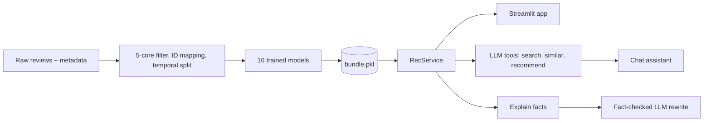

# 🛍️ Recommender-System-For-E-Commerce
Suggest personalized products to users.


An end-to-end recommender system with **16 models**, a two-stage retrieval-and-ranking pipeline, a business-rules
layer, time-based evaluation, a simulated A/B test, an LLM shopping assistant, and a Streamlit app with
"Why this?" explanations.

 


> **Read this first.** Most results below come from a **synthetic** shop I generated, which has built-in
> quirks that favor some models. A quick, untuned run on **real Amazon data** is reported separately and
> changes some conclusions. Business metrics (CTR, cart, conversion, revenue) are **simulated** from assumed
> probabilities, because the datasets contain no click logs.

## Features

| Area | What is included |
|---|---|
| Collaborative filtering | User-based and item-based KNN, SVD, ALS (pure NumPy), NCF (PyTorch) |
| Content-based | TF-IDF profiles (optional sentence embeddings) |
| Neural retrieval | Two-Tower dual encoder with in-batch negatives, logQ correction, ID dropout, FAISS search |
| Sequential | GRU4Rec-style and SASRec-style next-item models |
| Graph | LightGCN in plain PyTorch |
| Generative | TIGER-style model: semantic item IDs from text, a Transformer writes the next ID |
| Ranking | Candidate generation (4 sources), GBDT ranker, deep multitask ranker (MMoE + ESMM) |
| Hybrid + business layer | Rank fusion, MMR diversity, category cap, reserved slots for new items, stock filter |
| Evaluation | P/R/Hit/MRR/NDCG/MAP@K, temporal split, warm vs cold users, cold-item recall, coverage, novelty, Gini, paired bootstrap |
| Simulation | Funnel A/B test, A/A test, power analysis, live traffic stream |
| LLM layer | Natural-language "Why this?" with a fact checker, tool-using chat assistant (Groq) |
| App | 6-tab Streamlit app |

## Architecture



Serving flow for the two-stage model: **candidate sources** (Two-Tower via FAISS, ItemKNN, TF-IDF, popularity)
-> union (about 150 items) -> **ranker** -> **business layer** (stock, diversity, category cap, new-item slots).
Every model sits behind one shared rule: a user with no history gets popularity.

## Quick start

```bash
python -m venv .venv
.venv\Scripts\activate              # macOS/Linux: source .venv/bin/activate
pip install -r requirements.txt
pip install -e .

python prepare_data.py --synthetic  # about 10 s. Omit the flag for real Amazon data
python build_artifacts.py           # fits all models, saves artifacts/bundle.pkl (4-6 min on CPU)
python evaluate_all.py              # writes artifacts/leaderboard.csv
streamlit run app/streamlit_app.py
pytest -q
```

A `Makefile` wraps these: `make data build evaluate app test` (on Windows use Git Bash or install `make`).
The scripts live in the project root.

### Optional: LLM features (Groq)

```bash
pip install groq
set GROQ_API_KEY=your-key            # macOS/Linux: export GROQ_API_KEY=your-key
set RECSYS_LLM_MODEL=openai/gpt-oss-120b   # optional, this is the default
```

Without a key everything still works: plain explanations and a keyword-search assistant. Never commit your key.

### Real data

```bash
set RECSYS_CATEGORY=Software         # any Amazon Reviews 2023 category
set RECSYS_MAX_ROWS=0                # 0 = read the whole file
python prepare_data.py
python check_data.py                 # read the WARNINGS before training anything
python evaluate_real.py --quick
```

Other variables: `RECSYS_MIN_USER`, `RECSYS_MIN_ITEM` (k-core thresholds). The app's dense item-item tables
only fit about 8,000 items, so large catalogs need a smaller k-core before `build_artifacts.py`.

## Evaluation protocol

- **Global temporal split**, 80/10/10. Hyperparameters tuned on validation, scores reported on test.
- Items a user already owns are never recommended. Relevant = held-out interactions with rating >= 4.
- Test users are split into **warm** (seen in training) and **cold**. Cold users fall back to popularity for every model.
- **Cold-item recall** counts test purchases of items never seen in training.
- Models are trained on the train period only and **not refit on train+val** before testing, so scores are slightly conservative.

## Results on synthetic data

3,000 users, 800 items, 62,692 interactions, 97.9% sparse. 22% of test rows involve unseen items.
Test split, K=10, 1,941 graded users, one seed unless noted.

| Model | NDCG@10 | Cold-item recall@10 | Note |
|---|---|---|---|
| Rule: fresh x favorite | 0.1420 | 0.802 | no learning; generator-inflated |
| TwoStage (GBDT ranker) | 0.1417 | 0.433 | ties the rule; generator-inflated |
| Final: Generative + shelf rules | 0.0913 | 0.248 | business layer; partly generator effect |
| Generative | 0.0663 (3 seeds: 0.064) | 0.000 | significantly above UserKNN |
| Hybrid blend | 0.0583 | 0.000 | below Generative alone |
| SASRec | 0.0587 (3 seeds: 0.053) | 0.000 | not significantly above UserKNN |
| GRU4Rec, LightGCN, NCF, UserKNN, ItemKNN, TwoTower | 0.046 - 0.047 | about 0 | statistical ties |
| SVD / ALS | 0.044 / 0.041 | 0.000 | |
| Popularity | 0.022 | 0.000 | |
| Content-TFIDF | 0.020 | 0.038 | only model without history that sees new items |
| Random | 0.009 | | |

Serving latency is 0.1 to 6 ms per request for all 16 models (CPU, median of 30 requests).

### What the controls showed

- **The learned rankers add nothing over a one-line rule** (paired difference -0.0003, 95% CI [-0.011, +0.010]).
  Their scores measure how much my generator rewards "new items in the user's favorite aisle".
- **Generative beats SASRec** (+0.011, CI [+0.007, +0.016]). Randomizing the text-derived item addresses cost
  0.035 NDCG, so text structure carries signal.
- **History order matters in this data:** shuffling it cost SASRec 0.020 NDCG. The cause was not isolated.
- **Blending models did not help.** Rank fusion with Generative alone was best on validation.
- **Single-run noise is large** (SASRec ranged 0.047 to 0.059 across seeds), so small gaps are ties.

### Simulated A/B test (assumed click, cart and buy probabilities)

| Comparison | Revenue/user lift | 95% CI | Detected in 200 repeats |
|---|---|---|---|
| A/A (same model) | +27% | [-16%, +91%] | 5% (the false-alarm rate) |
| UserKNN -> Generative | +43% | [-8%, +123%] | 43% |
| Generative -> + shelf rules | +33% | [-8%, +93%] | 20% |
| UserKNN -> Rule | +155% | [+82%, +269%] | 98% |

With about 1,900 users, only the very large effect was reliably detected. The "loved" labels come from the same
test purchases as the offline metrics, so this shows how noisy small tests are, not independent evidence.

## Results on real data: Amazon Reviews 2023, Software (quick run)

146,396 users, 17,591 items, 1.28M interactions, 99.96% sparse. 55% of test rows come from unseen users and
32% involve unseen items. 92% of items share one category. One untuned config per model, one seed.

| Model | NDCG@10 (all) | NDCG@10 (warm users) |
|---|---|---|
| SASRec | 0.0414 | 0.0422 |
| Generative | 0.0356 | 0.0335 |
| TwoTower, UserKNN, SVD, ItemKNN | 0.0315 - 0.0319 | 0.027 - 0.028 |
| Popularity | 0.0223 | 0.0134 |
| Rule: fresh x favorite | 0.0161 | 0.0041 |

- Personalized models beat Popularity, and the paired intervals exclude 0.
- **The rule that won on synthetic data scores below Popularity here.** The synthetic finding does not transfer.
- Cold-item recall is near zero for every model (best 0.0075). Cold start remains unsolved on real data.
- Content-TFIDF, the two-stage ranker, GRU4Rec, LightGCN, NCF and ALS were not run on real data, and nothing was tuned.
- The Streamlit app serves the synthetic bundle only.

## LLM layer

- **Natural-language "Why this?"**: the recommendation facts are rewritten as a short sentence. A checker rejects any
  answer containing a number or quoted title that is not in the facts, and the plain facts are shown instead.
- **Chat assistant**: the LLM calls five tools (`search_products`, `similar_products`,
  `recommend_for_current_shopper`, `recommend_from_liked_products`, `get_product`). It may only cite products the tools
  returned. If it cites an unknown `[id:N]`, its answer is replaced by the tool results. The shopper ID comes from the
  app session, never from the model.
- **Limits:** the checker catches invented numbers and quoted titles, not a wrong claim in plain prose. Product text is
  treated as data, but prompt injection through titles is a mitigation, not a guarantee. Shopper history is sent to the
  API provider, so real customer data needs a privacy decision first.

## Project structure

```
src/recsys/
  data/         download, preprocess (5-core), temporal split, loader
  models/       baselines, knn, mf, content, neural, sequential, gnn, generative,
                ranker, deep_ranker, hybrid, rules, wrappers
  retrieval/    FAISS index + multi-source candidate generator
  evaluation/   metrics, evaluator, tuning, cold-item view, beyond-accuracy, stats, A/B simulator
  serving/      business rules, RecService
  llm/          Groq client, explanation checker, chat assistant
app/            Streamlit app
tests/          unit and app tests (none call the LLM API)
*.py (root)     prepare_data, check_data, build_artifacts, evaluate_* scripts
```

## Screenshots

| Recommendations | Compare models |
|---|---|
|  |  |

| Live clicks | A/B stream |
|---|---|
|  |  |

## Limitations

- Most results are on synthetic data. Re-tune and re-evaluate on real data before trusting any ranking.
- Business metrics and stock flags are simulated. The data has no real clicks, carts or inventory.
- One or three seeds per model. Bootstrap intervals treat users as independent and are slightly optimistic.
- Dense item-item tables and exact scoring suit about 1k items. Larger catalogs need approximate search everywhere.
- The `bundle.pkl` is loaded with `pickle`. Only load files you built yourself.

## Reproducibility

`pip freeze > requirements-lock.txt` pins exact versions. Training is deterministic for a fixed seed on the same machine.

## License

Choose a license (for example MIT) and add a `LICENSE` file. Amazon Reviews 2023 has its own terms of use.

## Acknowledgements

Amazon Reviews 2023 (McAuley Lab, UCSD). Model designs follow published work: NCF (He et al. 2017),
LightGCN (He et al. 2020), SASRec (Kang & McAuley 2018), TIGER (Rajput et al. 2023), MMoE and ESMM.
